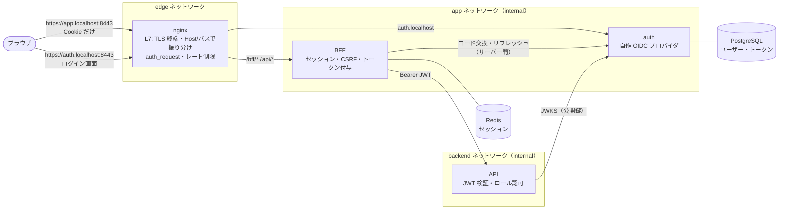

# auth-sandbox

Docker だけで、**リバースプロキシ（L7）→ BFF → API** の構成と、**自作の OpenID Connect 認証基盤**を手元に組み、
「どの層で・何を根拠に・リクエストを止めるのか」を動かして確かめるための学習用リポジトリです。

- ブラウザ ⇄ BFF は **ステートフル**（HttpOnly Cookie のセッション ID。中身は Redis）
- BFF ⇄ API は **ステートレス**（`Authorization: Bearer <JWT>`。API は JWKS で自分で検証）
- 認証基盤は Go で自作した最小の OIDC プロバイダ。**設定を差し替えるだけで Keycloak に置き換えられます**
- すべてのサービスは Go（標準の `net/http`）。外部に公開しているポートは nginx だけです

> 自作の認証基盤は学習用です。本番では Keycloak などの実績ある製品やマネージドサービスを使ってください。

## 構成



| 層 | 何を見て止めるか | 止めたときの応答 |
|---|---|---|
| nginx（L7） | 知らないホスト名、セッションの有無（`auth_request`）、ログインの連打 | TLS 握手の拒否・421・444・`401 {"rejected_by":"nginx"}`・429 |
| BFF | セッション（Redis）、CSRF トークンと Origin、ログインの state / nonce / PKCE | `401 / 403 {"rejected_by":"bff"}` |
| API | JWT の署名・`iss`・`aud`・`exp`、ロール | `401 / 403 {"rejected_by":"api"}` |
| Docker ネットワーク | そもそも届くか（nginx → API、nginx → Redis は届かない） | 名前解決できない |

## 動かす

必要なもの: Docker（Compose v2）、`make`、`openssl`、`jq`、`curl`。Go は単体テストを手元で回すときだけ使います。

**初めて使う人は、自分の環境で証明書を生成してください。開発者の証明書・秘密鍵をコピーして使う必要はありません。**

```bash
make setup             # .env・ローカル証明書・git フックを作成（既存ファイルは上書きしない）
make trust-local-cert  # macOS: サーバー証明書だけを信頼登録。OS の確認画面は自分で承認
make up                # 起動し、nginx → BFF → API の応答まで待つ
```

`make trust-local-cert` の意味と注意点は、次の「ローカルHTTPSと証明書」を確認してください。`make setup` だけでは信頼設定は変更しません。

ブラウザで https://app.localhost:8443 を開きます。デモユーザーは `alice`（editor）と `bob`（viewer）。初期パスワードは両方とも `sandbox-demo-pass` です。変更した場合は `.env` の `DEMO_PASSWORD` を使います。

- 全公開ポートは `127.0.0.1` に限定しています。同じ LAN の別端末からはアクセスできません。
- `app.localhost` / `auth.localhost` / `kc.localhost` を使います。単なる `https://localhost:8443` は nginx の許可ホストに含まれないため拒否されます。
- `*.localhost` の扱いはブラウザ・OS・名前解決環境によります。名前解決できない場合は、利用する環境で上記のホスト名を `127.0.0.1` に対応付けてください。E2E は `curl --resolve` を使って接続先を明示します。

画面から「ログイン → API を呼ぶ → CSRF トークンなしで POST → ログアウト」を試すと、どの層が止めたかが `rejected_by` に出ます。
通信の順番は [ログイン・API・ログアウトの図解](docs/06_auth_flow.md) にまとめています。

## ローカルHTTPSと証明書（初回利用時に読む）

### なぜ必要か

この構成は HTTPS と `Secure` / `__Host-` 属性付き Cookie を前提にしています。
証明書はブラウザが接続先を確認するためのものです。自前の発行元は通常は信頼されていないため、初回は警告になります。
これはユーザーのログイン認証とは別の仕組みです。TLS 証明書は nginx が提示し、JWT の署名鍵は認証基盤が別に持っています。

### 何を生成・登録するか

| ファイル・操作 | 用途と取り扱い |
|---|---|
| `nginx/certs/server.crt` | nginx が提示するサーバー証明書。macOS の手順ではこの証明書だけを登録する |
| `nginx/certs/server.key` | nginx の秘密鍵。共有・コミットしない |
| `nginx/certs/ca.crt` | ローカルの発行元の公開証明書。E2E の `curl --cacert` で使用する |
| `nginx/certs/ca.key` | OpenSSL で生成した場合の発行元の秘密鍵。共有・コミットしない。nginx にもマウントしない |
| `make trust-local-cert` | **現在の macOS ユーザーの SSL 用**に `server.crt` を信頼登録する。CA 全体やシステム全体への登録は行わない |

- 生成物は `nginx/certs/` ごと `.gitignore` の対象です。公開するのは生成手順であり、鍵そのものではありません。`.env` も共有・コミットしないでください。
- 信頼登録はセキュリティ設定の変更です。登録対象が自分で生成した今回の証明書であることを確認し、会社の端末では組織のルールに従ってください。
- サーバー秘密鍵が漏れると、この証明書を利用したなりすましのリスクがあります。CA 全体を信頼する場合は、そのCAが発行する別の証明書にも影響が及ぶため、この手順では登録対象をサーバー証明書に限定しています。
- `mkcert` が入っている場合は生成に使います。その発行元の秘密鍵は mkcert が管理します。mkcert のインストールと信頼登録は別です。このプロジェクトのコマンドは `mkcert -install` を自動実行しません。すでに別途登録した CA の信頼設定を狭めたり解除したりするものでもありません。
- `make trust-local-cert` は macOS 専用で、Windows / Linux では実行できません。OS・ブラウザの証明書管理の手順に従ってください。本リポジトリではそれらの信頼登録手順は未検証です。

### 確認とトラブルシュート

macOS で登録した後、ブラウザを再読み込みします。通常の HTTPS 接続で確認する場合:

```bash
curl https://app.localhost:8443/api/public/hello
```

`hello from api` の JSON が返れば、HTTPS で nginx → BFF → API に到達できています。
クライアントによっては OS と異なる証明書ストアを使うため、OS の登録がそのまま反映されない場合があります。
警告が残る場合は、URL、証明書の期限、登録した証明書が現在の `server.crt` と同じか、利用ブラウザの証明書設定を確認してください。

OS の信頼設定を変更せず、生成した CA をその1回の接続だけに指定して確認することもできます。これはブラウザへの信頼登録ではありません。

```bash
curl --cacert nginx/certs/ca.crt \
  --resolve app.localhost:8443:127.0.0.1 \
  https://app.localhost:8443/api/public/hello
```

証明書の警告を無視したり、`curl -k` で検証を無効にしたりすることを、通常の利用手順にはしません。

### 解除・作り直し・利用終了

**フォルダ削除や `make down` / `make clean` では、macOS に登録した信頼設定は消えません。**
不要になったら、元の証明書ファイルを消す前に次を実行します。

```bash
security remove-trusted-cert nginx/certs/server.crt
```

これは信頼設定の解除です。キーチェーンから証明書自体も削除したい場合は、キーチェーンアクセスで今回の証明書を特定して削除してください。
同じ `app.localhost` という名前の証明書が複数ある場合は、有効期間やフィンガープリントも照合し、別プロジェクトの証明書を削除しないでください。

期限切れ・再生成が必要な場合は、**古い証明書の信頼設定を解除 → `make down` → ローカル生成物 `nginx/certs/` を削除 → `make setup` → `make trust-local-cert` → `make up`** の順に進めます。
この操作で `.env` や DB のボリュームを削除する必要はありません。`make setup` は既存の証明書を自動更新しないため、期限切れのまま再実行しても置き換わりません。

## 確かめる（完了の定義）

```bash
make verify    # gofmt・vet・機密検査・compose 構成・単体テスト・起動して E2E（80 件以上）
```

E2E（[`scripts/e2e.sh`](scripts/e2e.sh)）は「通るべきものが通る」だけでなく、**「止まるべきものが止まる」**を確かめます。
例: nginx から API には届かない、`alg=none` の偽造トークンは 401、ID トークン（aud が違う）では API を呼べない、
リフレッシュトークンを2回使うと系統ごと失効する、`return_to` で外部サイトへは戻らない、など。

## フェーズごとに追う

`git checkout phase-0` のように、タグで順に追えます。各フェーズの受け入れ基準は [docs/TASKS.md](docs/TASKS.md)。

| タグ | 内容 | 解説 |
|---|---|---|
| `phase-0` | nginx（L7）・静的フロント・ネットワーク分割 | [docs/01_network.md](docs/01_network.md) |
| `phase-3` | BFF のセッション・自作 OIDC・JWT 検証・リフレッシュ・CSRF・auth_request | [docs/02_bff_session.md](docs/02_bff_session.md)・[docs/03_oidc.md](docs/03_oidc.md) |
| `phase-4` | Keycloak への差し替え（`make e2e-keycloak`） | [docs/04_keycloak.md](docs/04_keycloak.md) |
| `phase-5` | L4（TCP）プロキシと BFF のスケールアウト | [docs/05_l4_and_scale.md](docs/05_l4_and_scale.md) |

## よく使うコマンド

| コマンド | 内容 |
|---|---|
| `make up` / `make down` / `make clean` | 起動 / 停止 / ボリュームも消す |
| `make logs` | ログ（nginx・BFF・API が同じ `request_id` で追える） |
| `make e2e-up` → `make e2e` | トークンの期限を 15 秒にして起動し、E2E（リフレッシュも確認） |
| `make scale` | BFF を3台に増やす |
| `make up-keycloak` / `make e2e-keycloak` | 認証基盤を Keycloak に差し替える |
| `NGINX_AUTH_REQUEST=off make up` | nginx の関門を外し、BFF・API の層だけで止まる様子を見る |

## AI と一緒に開発するためのハーネス

このリポジトリは AI（Claude Code など）に実装を任せる前提で、**間違えたら機械が止める仕組み**を先に用意しています。
入口は [AGENTS.md](AGENTS.md)、設計の意図は [docs/harness.md](docs/harness.md)。

- 完了の定義は `make verify` が緑であること（E2E が中心）
- コミット前に機密検査（秘密鍵・`.env`・JWT・個人のパスやメール）と gofmt（`.githooks/pre-commit`）
- `.claude/settings.json` で、検査の迂回や秘密の読み取りを禁止し、push などの外に出る操作は人の確認を求める
- 認証まわりの変更は、仕様だけを渡した独立の評価役（`.claude/agents/reviewer.md`）が確認する。実際にオープンリダイレクトを見つけています（[記録](docs/TASKS.md#評価役の記録)）
