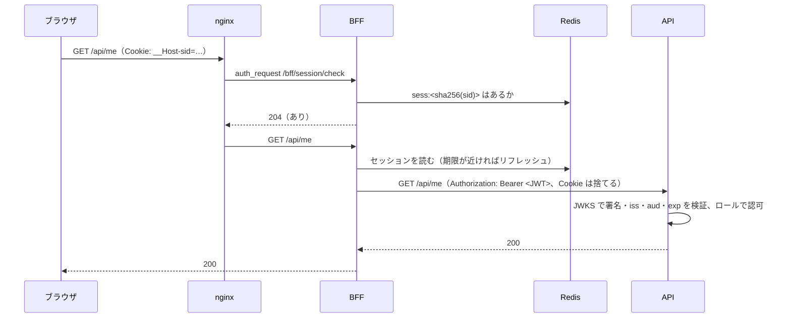

# 02 BFF とセッション（ステートフル）⇄ API とトークン（ステートレス）

## なぜ BFF か

SPA が自分でアクセストークンを持つと、XSS が1つあればトークンを盗まれ、攻撃者の環境から API を呼ばれます。
BFF パターンでは**ブラウザはトークンを一切持たず**、HttpOnly Cookie（JavaScript から読めない）のセッション ID だけを持ちます。
XSS があっても「その画面の中で操作される」被害にとどまり、トークンを持ち出されることはありません。

## セッションの作り（`services/bff/session.go`）

| 決めごと | 理由 |
|---|---|
| Cookie は `__Host-sid`・`HttpOnly`・`Secure`・`SameSite=Lax`・`Path=/` | `__Host-` を付けると、ブラウザは Secure・Path=/・Domain なしでなければ受け付けない（サブドメインからの上書きを防ぐ） |
| Redis のキーは `sess:` + SHA-256(セッション ID) | Redis の中身が漏れても、キーをそのまま Cookie にしてなりすませない |
| アイドル期限（30分・使うと延びる）と絶対期限（8時間・延びない） | 放置されたセッションを早く消し、使い続けても永遠には続かないようにする |
| ログインのたびに新しい ID を発行し、古い ID は消す | セッション固定攻撃の対策 |
| BFF を何台にしても Redis を共有 | どの台に当たっても同じセッション（[05](05_l4_and_scale.md)） |

## CSRF（`checkCSRF`）

Cookie は自動で送られるので、他サイトから「POST させる」攻撃（CSRF）を考える必要があります。状態を変えるメソッドでは次の両方を求めます。

1. `Origin` ヘッダが自サイト（`https://app.localhost:8443`）
2. `X-CSRF-Token` ヘッダが、セッションに結びついたトークンと一致（`GET /bff/session` で受け取る）

`SameSite=Lax` だけでも多くは防げますが、同じサイトの別オリジン（他のサブドメイン）や古いブラウザがあるため二重にしています。

## リフレッシュ（`freshToken`）

アクセストークンは短命（既定 5 分）。期限が近づいたら BFF がリフレッシュトークンで取り直します。ブラウザは何も知りません。

- リフレッシュトークンは使うたびに入れ替わる（ローテーション）。同じものを2回使うと、認証基盤は「盗まれた」とみなして系統ごと失効させる
- だから、同じセッションから同時にリクエストが来ても**リフレッシュは1回だけ**にする（Redis の `SET NX` でロック。BFF が複数台でも効く）
- `make e2e-up` はトークンの期限を 15 秒にして起動するので、画面の「アクセストークンの期限」が API を呼ぶたびに延びるのを観察できます

## ログアウト

1. BFF: Redis のセッションを消し、リフレッシュトークンを認証基盤の `/revoke` で失効させる
2. ブラウザ: BFF が返した `logout_url`（認証基盤の end_session）へ遷移し、認証基盤側のログイン状態（SSO）も終える

1 だけだと、次のログインで認証基盤がフォームを出さずに通してしまいます（SSO）。E2E の P3-4 で両方の動きを確かめています。
`logout_url` に `id_token_hint` は付けません。付けると ID トークンがブラウザの URL・履歴に出てしまうためです。
