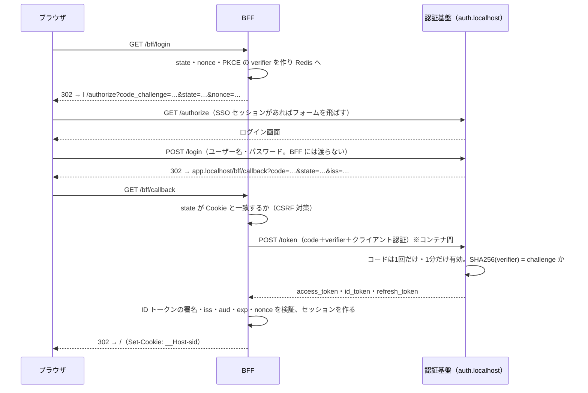

# 03 自作の OIDC 認証基盤（`services/auth`）

Keycloak などと同じ「OpenID Connect の認可コードフロー＋PKCE」を、必要最小限だけ Go で実装しています。
**発行する側だけを自作し、検証する側（BFF・API）は `coreos/go-oidc` を使う**、という分け方にしています。
検証を自作すると穴を作りやすく、学びたいのは「何が発行され、何が検証されるか」だからです。

## ログインの流れ

## 各パラメータが防ぐもの

| 仕組み | 防ぐもの |
|---|---|
| `redirect_uri` の**完全一致** | 認可コードを攻撃者のサイトに送らせる（前方一致は不可） |
| `state`（BFF が Cookie と照合） | 攻撃者のログインに巻き込まれる（ログイン CSRF） |
| PKCE（S256 のみ） | 横取りした認可コードを交換される |
| `nonce`（ID トークンに入る） | 古い ID トークンの使い回し |
| 認可コードは1回・1分 | コードの再利用 |
| 応答の `iss`（RFC 9207） | 複数の IdP を使うときの取り違え |
| アクセストークンの `aud=sandbox-api`、ID トークンの `aud=sandbox-bff` | ID トークンで API を呼ぶ、などの取り違え（E2E P2-5） |
| 署名は ES256、検証側はアルゴリズムを許可リストで固定 | `alg=none` などへのすり替え |
| リフレッシュトークンのローテーションと再利用検知 | 盗まれたリフレッシュトークンを使い続けられる |
| パスワードは argon2id、存在しないユーザーでも同じ計算 | ハッシュの漏えい時の総当たり、応答時間でのユーザー名の推測 |
| トークン類は DB に SHA-256 だけを保存 | DB が漏れたときに、そのまま使えるトークンが出てくる |
| ログイン POST のレート制限（nginx） | パスワードの総当たり |

## コンテナ構成ならではのつまずき: issuer が2つある

ブラウザから見た認証基盤は `https://auth.localhost:8443`、BFF・API から見ると `http://auth:8080`。
トークンの `iss` は前者でなければなりません（ブラウザが見ている IdP と一致させるため）。そこで:

- `iss`・認可エンドポイント・end_session は**外から見える URL**
- トークン・JWKS・失効のエンドポイントは**コンテナ間の URL**

と分けて設定しています（`compose.yaml` の `OIDC_*`）。ディスカバリ（`.well-known`）を使って自動で取らせると、
外向きの URL がそのまま返ってきてコンテナからは届かない、というのが Keycloak でもよくハマる点です。

## 鍵

署名鍵は起動のたびにメモリ上で作り直します。認証基盤を再起動すると、それまでのアクセストークンは API で検証できなくなり、
BFF がリフレッシュで新しい鍵のトークンを取り直します（API は知らない `kid` を見ると JWKS を取り直す）。鍵のローテーションを体感できます。

## 省いたもの（学習用として意図的に）

| 省いたもの | 本番なら | なぜ省いたか |
|---|---|---|
| 鍵の永続化・計画的なローテーション（新旧の鍵を並べて公開） | KMS などに置き、JWKS に新旧を並べる | 再起動で作り直す方が、ローテーションの影響が見えやすい |
| `GET /logout` の呼び出し元の確認（`id_token_hint` や確認画面） | 確認画面を出すか、`id_token_hint` を必須にする | `id_token_hint` を使うと ID トークンがブラウザに出る。他サイトから IdP をログアウトさせられる（評価役の指摘・低） |
| 再利用された認可コードから発行済みのトークンの失効 | RFC 6749 では SHOULD | コードは1回しか交換できないことは守っている（評価役の指摘・低） |
| 同意画面・複数クライアントの管理・動的登録 | 必要に応じて | このリポジトリのクライアントは BFF の1つだけ |
| 多要素認証・アカウントロック | 必須 | Keycloak に差し替えると使える（[04](04_keycloak.md)） |
