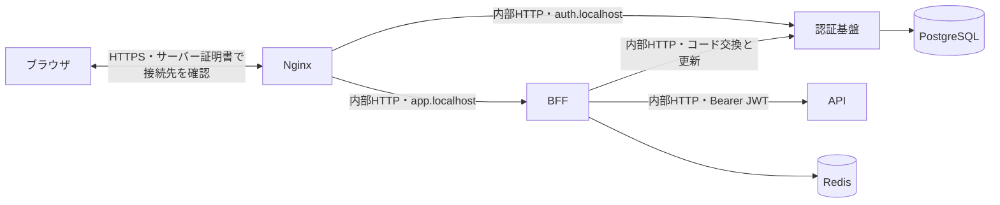
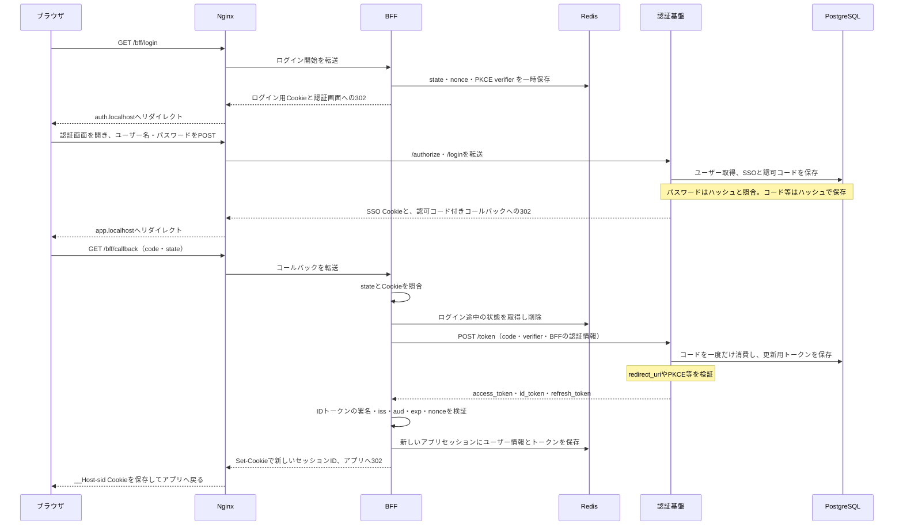
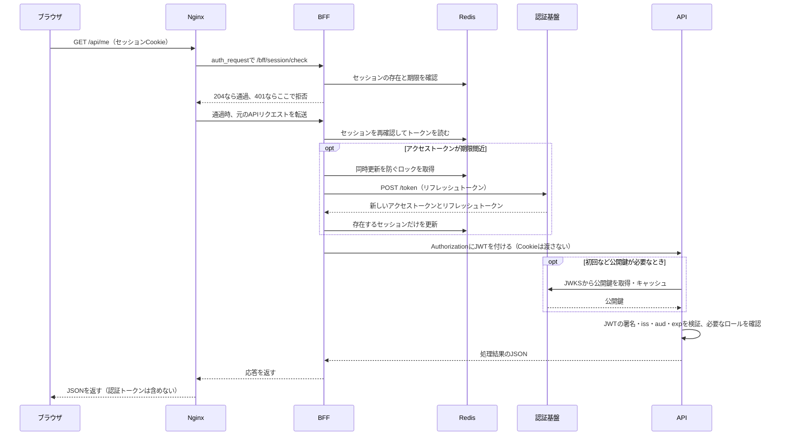
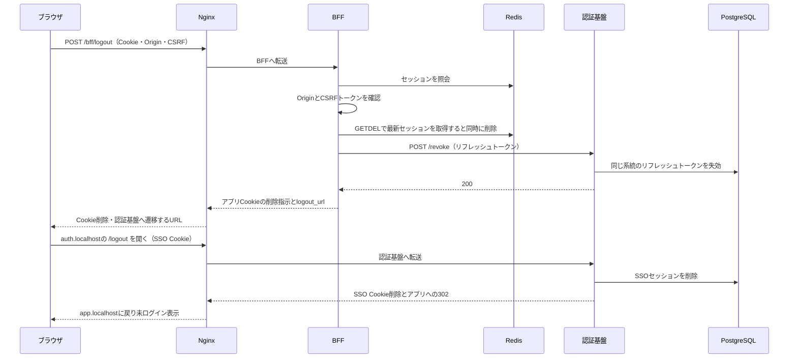

# 06 ログイン → API 呼び出し → ログアウトを追う

対象は既定の **自作 Go 認証基盤**です。Keycloak の差分は [04](04_keycloak.md)、証明書の初回設定・解除は [README](../README.md) を参照してください。

## 何を誰が持つか

| 場所 | 主な役割・保持するもの |
|---|---|
| ブラウザ | アプリ用セッションIDの Cookie、認証基盤用SSOの Cookie。アクセストークン・IDトークン・リフレッシュトークンは受け取らない |
| Nginx | ブラウザとのHTTPSを終端し、Hostとパスで転送。APIの前段でセッション確認をBFFに依頼する |
| BFF | ログイン手続き、セッション照会、CSRF対策、トークン管理、APIへの転送 |
| Redis | BFFのログイン途中の状態、アプリのセッション（ユーザー情報・トークン・CSRF値・期限）、リフレッシュの排他制御 |
| 認証基盤 | パスワード検証、認可コードとトークンの発行・失効、SSOセッションの管理 |
| PostgreSQL | 認証基盤が使うユーザーのパスワードハッシュ、認可コード・リフレッシュトークン・SSOセッションのハッシュ等 |
| API | JWTの署名・発行元・宛先・期限を検証し、ロールに従って処理する。Redisセッションは読まない |

## 証明書が働く場所

TLSのサーバー証明書と、JWTに署名する鍵は**別物**です。
サーバー証明書を信頼しても、ログイン済みにはなりません。HTTPSで安全に接続した後で、以下のユーザー認証を行います。

ブラウザからの通信はNginxで復号されます。そのため、ログイン時のパスワードはNginxを通過しますが、BFFやAPIには送られません。
コンテナ間通信は今回HTTPで、Dockerネットワークを分離しています。ネットワーク分離自体が通信を暗号化するわけではありません。

## 1. ログインする

ブラウザが一時的に運ぶ **認可コード** は、APIを呼ぶ **アクセストークン** とは別物です。
コードはBFFがサーバー間通信でトークンに交換します。PKCEは、ログイン開始時の秘密の値（verifier）を持つBFFがコードを交換していることを確認する仕組みです。
`state` は開始したログインとの対応、`nonce` は受け取るIDトークンとの対応を確かめます。

ブラウザがアプリへの次のリクエストに送るのは、推測困難なIDを入れた `__Host-sid` Cookieです。ユーザー情報やトークンの本体はRedisにあります。
`HttpOnly` なので画面のJavaScriptはこのCookieを読めず、`Secure` なのでHTTPS接続で送ります。

ここでログイン状態は2つできます。

| ログイン状態 | ブラウザ側 | サーバー側 |
|---|---|---|
| アプリのセッション | app.localhost の `__Host-sid` | BFFがRedisで管理 |
| 認証基盤のSSOセッション | auth.localhost の `__Host-auth_sso` | 自作認証基盤がPostgreSQLで管理 |

認証基盤のSSOが残っている場合、次のログインではパスワード画面を省略できます。

## 2. APIを呼ぶ

次は認証が必要な `/api/me` の例です。`/api/public/hello` は認証を要求しません。

NginxはRedisを直接読みません。BFFに確認を頼み、未ログインなら早い段階で止めます。
BFF自身もセッションを確認するため、Nginxの確認だけに依存しません。
APIはCookieやRedisを知らず、JWTで利用者を確かめます。公開鍵をキャッシュしているため、認証基盤に毎回問い合わせる必要はありません。

POSTなど状態を変える操作では、BFFが `Origin` とセッションに結びついた `X-CSRF-Token` も確認します。
CSRFトークンはフロントへ渡しますが、API認証用のアクセストークンとは用途が違います。
APIでメモを書き込む場合は `editor` ロールが必要で、`alice` は201、`bob` は403になります。

## 3. ログアウトする

**BFFのセッションと認証基盤のSSOの両方を終える**のがポイントです。
自作認証基盤ではBFF側だけログアウトしてもSSOが残るので、次のログインがパスワード入力なしで成立することがあります。
画面のログアウトボタンは、返されたURLへの移動まで行って両方を終了します。

ログアウトと更新が重なっても、更新側の `SET XX` は削除済みセッションを再作成しません。
遅れて発行されたリフレッシュトークンも失効を試みます。Redisの削除に失敗した場合、BFFは500を返してログアウト成功と扱いません。
認証基盤への失効要求が失敗した場合はログを残してアプリ側のログアウトを進めるため、失効が常に成功する保証ではありません。

発行済みJWTの有効期限を即座に消す仕組みではありません。独立して検証するAPIにとってJWTは期限まで有効になり得ます。
ただしブラウザはJWTを持たず、Redisセッションが消えた後のブラウザからの呼び出しは拒否されます。すでに認証を通過した処理も巻き戻しません。

## コードと見比べる

- 入口の転送と `auth_request`: [nginx/templates/default.conf.template](../nginx/templates/default.conf.template)
- ログイン・コールバック・更新・ログアウト: [services/bff/auth.go](../services/bff/auth.go)
- Redisのセッション操作: [services/bff/session.go](../services/bff/session.go)
- コード・トークン・SSO: [services/auth/oidc.go](../services/auth/oidc.go)・[store.go](../services/auth/store.go)
- JWT検証とロール認可: [services/api/main.go](../services/api/main.go)
